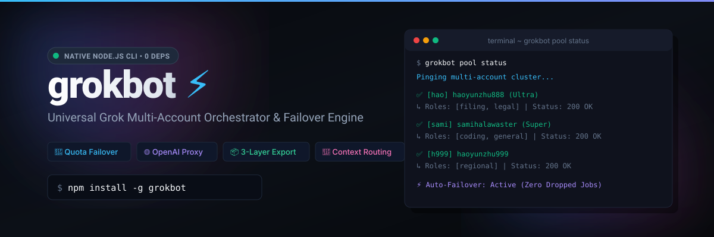
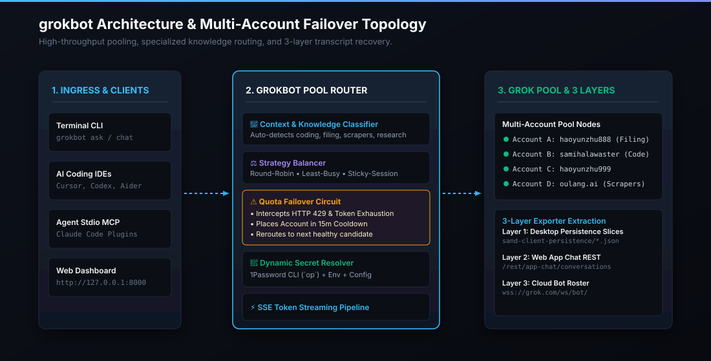

<p align="center">
  
</p>

<p align="center">
  <a href="https://www.npmjs.com/package/grokbot"></a>
  <a href="https://nodejs.org/"></a>
  <a href="package.json"></a>
  <a href="tests/"></a>
  <a href="LICENSE"></a>
</p>

<p align="center">
  <strong>Universal Grok &amp; Grok Bot CLI • Multi-Account Orchestrator • Local OpenAI Proxy</strong><br>
  Parallel quota pooling, zero-downtime 429 failover, specialized knowledge routing, and 3-layer conversation export.
</p>

<p align="center">
  <code>0 External Dependencies</code> • <code>No External Databases</code> • <code>Native Node.js (v20+)</code>
</p>

---

### ⚡ 10-Second Quickstart

```bash
# 1. Install globally (or use npx grokbot)
npm install -g grokbot

# 2. Add your Grok session cookie (or export GROK_SSO=...)
grokbot pool add --name primary --sso "<sso_cookie>"

# 3. Ask anything with live token streaming
grokbot ask "Explain the Paxos consensus algorithm in 2 sentences"
```

---

## 🏗️ Architecture & Topology

<p align="center">
  
</p>

---

## ⚡ Comparison

| Feature | Official Web | `gbot` (ScriptedAlchemy) | **`grokbot`** |
| :--- | :---: | :---: | :---: |
| **Dependencies** | Heavy / Electron | Node + gateway | **0 Dependencies (Pure Node.js)** |
| **Databases** | Cloud / Sand | App sand store | **Zero external databases** |
| **Multi-Account Cluster** | ❌ None | ❌ Single session | ✅ **Round-Robin, Least-Busy, Batch** |
| **Quota Failover (HTTP 429)**| ❌ Blocked | ❌ Error exit | ✅ **Automatic transparent retry** |
| **Domain Auto-Routing** | ❌ None | ❌ None | ✅ **Auto-detects coding, filing, scrapers** |
| **Conversation Recovery** | Web only | Container only | ✅ **All 3 Layers (Local + Web + Gateway)** |
| **Export Token Overhead** | ❌ None | ❌ Verbose JSON | ✅ **Markdown (78% token savings)** |
| **Local OpenAI Proxy** | ❌ None | ❌ None | ✅ **`/v1/chat/completions` + Web UI** |
| **Secret Management** | Browser storage | Keyring | ✅ **1Password CLI (`op`) + Env + Config** |
| **Native MCP Server** | ❌ None | ❌ Manual socket | ✅ **Built-in stdio for Claude / Cursor** |

---

## 🚀 Core Features

### 1. Multi-Account Parallel Pooling & Failover
Pool multiple accounts into one high-throughput cluster. If an account hits **HTTP 429** or quota exhaustion, `grokbot` triggers a **15-minute cooldown** and instantly serves the prompt from the next healthy account with zero dropped jobs.

```bash
# Add accounts (static tokens or dynamic 1Password references)
grokbot pool add --name coder --sso "<token>" --roles coding
grokbot pool add --name legal --op-id "op_item_id" --roles filing,legal

# Check real-time cluster health
grokbot pool status
```

---

### 2. Parallel Batch Processing (`grokbot batch`)
Process hundreds of prompts concurrently across your account pool:

```bash
grokbot batch prompts.jsonl --concurrency 4 --output results.jsonl
```

*Automatically balances load across accounts and pauses rate-limited nodes without stopping the batch.*

---

### 3. 3-Layer Exporter (~78% Fewer Tokens)
Recovers transcripts across Grok's 3 distinct storage layers:
1. **Local Persistent Slices** (`sand-client-persistence`) — offline replica turns.
2. **Web App Chat REST API** (`/rest/app-chat`) — user threads and response trees.
3. **Gateway Roster** — live bot transcripts.

```bash
# Export to clean, token-efficient Markdown
grokbot export --format markdown --output ~/grok_archive.md

# Calculate token savings on any prompt file
grokbot tokens ~/grok_archive.md
```

> [!NOTE]
> **Token Benchmark:** 8.85 MB of raw JSON (~2.21M tokens) formats into 1.92 MB of clean Markdown (~480k tokens) — saving **~78% context window overhead**.

---

### 4. Local OpenAI Proxy & Web Dashboard (`grokbot serve`)
Spin up a local OpenAI-compatible server at `http://127.0.0.1:8000/v1`:

```bash
grokbot serve --port 8000
```

- **Web Dashboard:** Open `http://localhost:8000/` to inspect real-time account quotas and test prompts interactively.
- **Cursor / Claude Code / Codex:** Set `Base URL` to `http://127.0.0.1:8000/v1` and use model `grok-3` or `grok-3-deepsearch`.
- **Python / Node.js SDK:**

```javascript
import OpenAI from 'openai';
const client = new OpenAI({ baseURL: 'http://127.0.0.1:8000/v1', apiKey: 'ignored' });

const res = await client.chat.completions.create({
  model: 'grok-3',
  messages: [{ role: 'user', content: 'Design a distributed lock in Redis' }],
  stream: true,
});
for await (const chunk of res) process.stdout.write(chunk.choices[0]?.delta?.content || '');
```

---

### 5. Native MCP Server (Claude Code & Cursor)
Expose Grok tools directly to AI pair programmers via Model Context Protocol:

```json
{
  "mcpServers": {
    "grokbot": {
      "command": "npx",
      "args": ["grokbot", "mcp"]
    }
  }
}
```

---

## 📖 Commands Cheatsheet

| Command | Description | Example |
| :--- | :--- | :--- |
| `ask <prompt>` | Query Grok with streaming token output | `grokbot ask "Write quicksort in Go" --role coding` |
| `chat` | Interactive multi-turn terminal REPL | `grokbot chat --model grok-3` |
| `batch <file>` | Concurrently dispatch batch prompts | `grokbot batch prompts.jsonl --concurrency 4` |
| `pool list` | View pool accounts, roles, and status | `grokbot pool list` |
| `pool status` | Ping all pool accounts for live auth | `grokbot pool status` |
| `pool add` | Register an account profile | `grokbot pool add --name hao --sso "<token>"` |
| `export` | Extract transcripts from all 3 layers | `grokbot export --format markdown -o backup.md` |
| `tokens <file>`| Calculate token density and savings | `grokbot tokens prompt.txt` |
| `serve` | Start OpenAI proxy server & Web UI | `grokbot serve --port 8000` |
| `doctor` | Diagnose local desktop slices & auth | `grokbot doctor` |
| `mcp` | Start stdio Model Context Protocol | `grokbot mcp` |

---

## 📄 License

MIT © [Sami Halawa](https://samihalawa.com)
